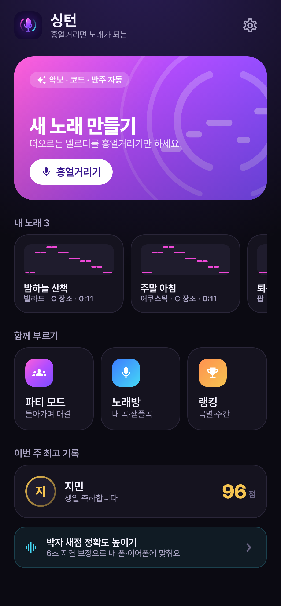
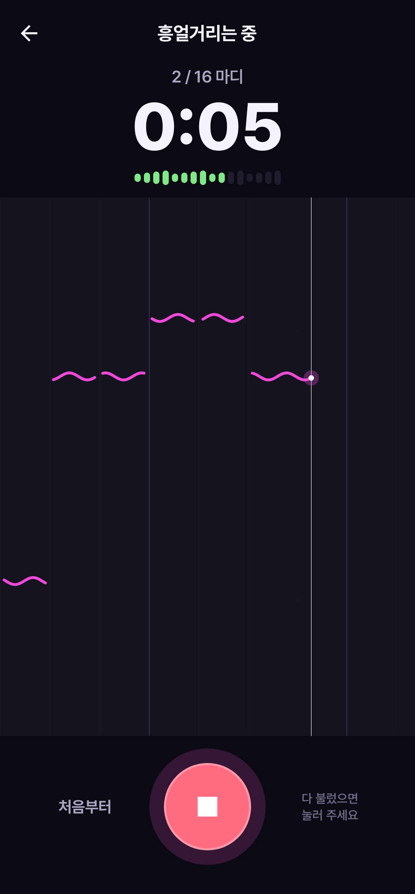
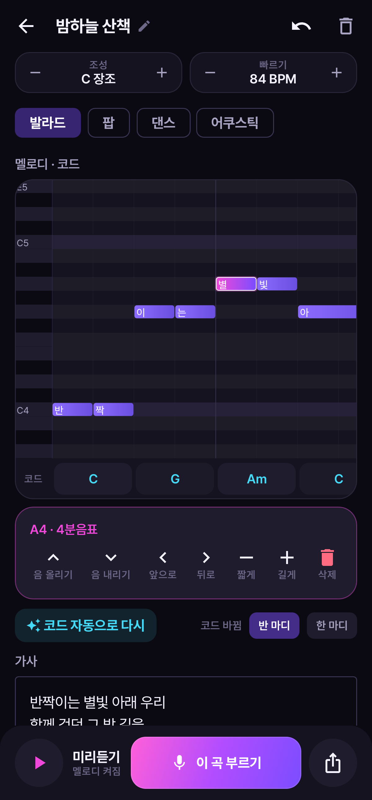
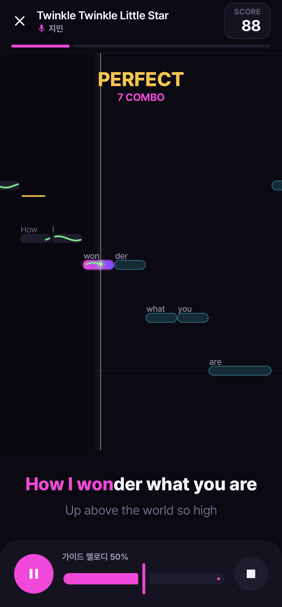
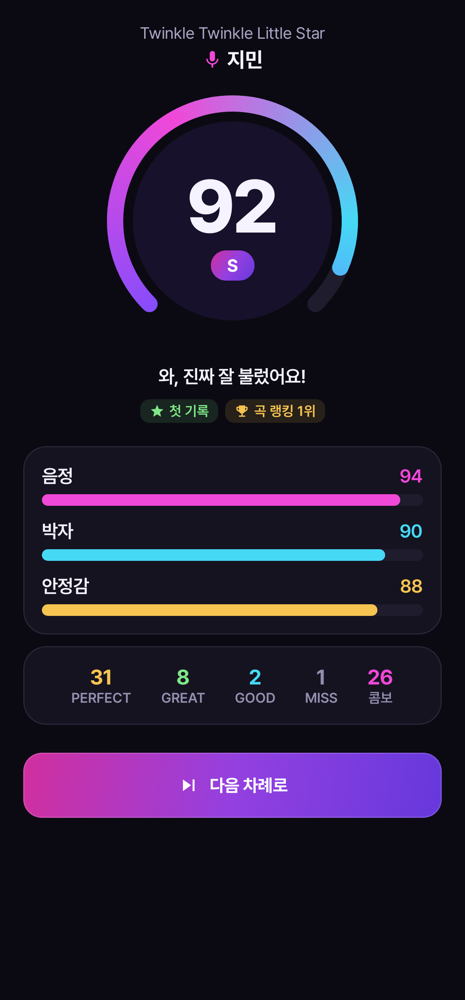

# 싱턴 (SingTurn)

**흥얼거리면 노래가 되는** 안드로이드 작곡 앱. 떠오르는 멜로디를 흥얼거리면 악보·코드·반주가 자동으로 만들어지고, 그 곡으로 바로 노래방 채점과 친구들과의 파티 대결까지 할 수 있습니다.

<p>





</p>

## 만드는 흐름

```
흥얼거리기 → 악보 자동 변환 → 코드·반주 자동 생성 → 멜로디·가사 다듬기 → 부르기 · 파티 · 음원 내보내기
```

| 단계 | 기능 |
|---|---|
| **녹음** | 장르·빠르기·박자 선택 → 메트로놈 카운트인 → 최대 16마디, 실시간 음높이 궤적과 입력 레벨 |
| **악보 변환** | 끊김 메우기·중앙값 필터로 비브라토 제거 → 음 단위 분할 → 전체 음정 치우침 보정 → 조성 찾기(Krumhansl) → 음계·8분음표 격자에 맞추기 |
| **자동 코드** | 반 마디(또는 한 마디)마다 멜로디에 맞는 다이어토닉 코드, 자연스러운 진행을 비터비 알고리즘으로 선택 |
| **편집** | 피아노 롤(음계 줄 강조) · 음 추가/높이/위치/길이/삭제 · 되돌리기 · 곡 전체 키 바꾸기 · 코드 직접 고르기 · 자동 저장 |
| **가사** | 한 글자 = 한 음, 영어는 단어(하이픈으로 음절 나누기), 줄바꿈 = 노래방 줄바꿈, 음표 수와 맞는지 안내 |
| **반주** | 발라드(피아노 아르페지오) · 팝(블록 코드) · 댄스(4비트·신스) · 어쿠스틱(Karplus–Strong 통기타 스트럼) |
| **완성** | 이 곡으로 노래방 채점·랭킹·파티 모드, WAV 내보내기(멜로디 포함 / 반주만 MR) |

## 노래방 · 파티 기능 (그대로 유지)

| 기능 | 내용 |
|---|---|
| **파티 모드** | 참가자 등록 → 곡 예약 → 순서 자동 진행 (차례대로 / 랜덤 / 꼴찌 먼저), 넘기기, 카운트다운, 오늘의 순위, 벌칙 룰렛 |
| **실시간 채점** | YIN 음정 검출 → 음정·박자·안정감, PERFECT~MISS 판정, 콤보 |
| **랭킹** | 곡별(내 노래 포함) · 이번 주 · 플레이어 |
| **샘플곡 · 내 MR** | 퍼블릭 도메인 7곡, 기기의 MR 파일 재생 |

## 저작권

| 구성 요소 | 처리 방식 |
|---|---|
| 내가 만든 곡 | 사용자가 직접 만든 멜로디·가사 → 사용자 소유 |
| 반주 | 녹음 음원 없이 앱이 실시간 합성 |
| 샘플곡 | 저작자 사후 70년이 지난 퍼블릭 도메인 곡만 수록 |
| 내 MR | 기기에서 재생만, 업로드·공유 없음 |
| 마이크 | 실시간 분석에만 사용, 녹음 파일로 저장·전송하지 않음 |

## 샘플곡 추가하기

`app/src/main/assets/songs.json`에 다음 형식으로 추가합니다.

```json
{
  "id": "my-song", "title": "곡 제목", "credit": "작사·작곡", "license": "퍼블릭 도메인",
  "bpm": 100, "beatsPerBar": 4,
  "lines": ["C4/1/가- D4/1/사 E4/2/한줄"],
  "chords": "C/4"
}
```

- 음표: `음이름/박자/가사` (`C4`=가온 도, `F#4`, `Bb3`), 쉼표 `R/박자`
- 가사 끝의 `-`는 다음 음절과 붙여 표시 (`생-` `일` → "생일")
- 코드: `코드/박자` (`C`, `Am`, `G7`, 코드 없음 `N`), 전체 길이가 멜로디와 같아야 합니다 (테스트로 검증)

## 디자인

| 요소 | 내용 |
|---|---|
| 앱 아이콘 | Canva AI로 시안 생성 → 마이크를 감싸는 두 개의 호("번갈아 부르기")를 벡터로 재작업 (어댑티브·테마 아이콘 지원) |
| 글꼴 | Pretendard (SIL OFL 1.1), 한글 2,350자 서브셋으로 용량 1.6MB |
| 색 | 아이콘의 마젠타→바이올렛 그라디언트를 메인으로, 바탕은 차분한 남보라 |
| 이모지 제거 | 메달·왕관·마이크 등은 이모지 대신 그라디언트 배지와 Material 아이콘으로 표현 |

화면 스크린샷은 `./gradlew recordRoborazziDebug`로 다시 만들 수 있습니다 (`docs/screenshots/`).

## 기술 스택

- Kotlin 2.0 · Jetpack Compose (Material 3) · Navigation Compose
- Room (점수·내 MR 저장) · kotlinx.serialization
- AudioTrack 스트리밍(합성 반주) · MediaPlayer(내 MR) · AudioRecord + 에코 캔슬러(마이크)

```
app/src/main/java/com/singturn/
├── studio/     Transcriber(허밍→악보) · Harmonizer(자동 코드) · LyricsFitter · Composition · MusicTheory
├── audio/      Synth · Arranger(장르별 편곡) · PitchDetector(YIN) · MicCapture · SongPlayer · WavWriter · LatencyCalibrator
├── scoring/    Scorer (음정·박자·안정감, 판정·콤보, MR용 참고 점수)
├── party/      PartySession (순서 규칙 · 예약 · 순위, 순수 로직)
├── data/       곡 파서 · Room DB · 설정
└── ui/         home · studio(녹음·편집) · party · songs · sing · result · ranking · settings
```

## 빌드 & 테스트

```bash
./gradlew testDebugUnitTest   # 단위·화면 테스트 47개 (허밍→악보 복원·자동 코드·가사·채점·순서 규칙·장르 합성·화면 스크린샷)
./gradlew assembleDebug       # app/build/outputs/apk/debug/app-debug.apk
```

Android Studio에서 프로젝트 폴더를 열고 ▶ 실행해도 됩니다. (minSdk 26 / targetSdk 35)
