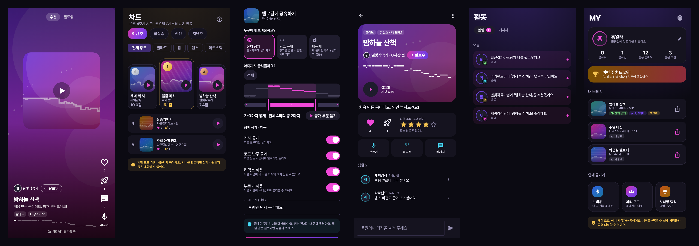

# 멜로딜 (Melodeal)

**흥얼거리면 노래가 되고, 사람들과 나누는** 안드로이드 앱. 떠오르는 멜로디를 흥얼거리면 악보·코드·반주가 자동으로 만들어지고, 멜로딜에 공유해 평가를 받고 제작자와 대화할 수 있습니다. 만든 곡으로 노래방 채점과 파티 대결도 됩니다.



## 메뉴 구조

```
[홈]        [차트]        [＋ 만들기]        [활동]          [MY]
추천|팔로잉   이번 주·급상승   흥얼거려 만들기    알림|메시지       내 노래(공개 상태)
세로로 넘기며  신인·지난주     이어서 편집        좋아요·추천·      받은 좋아요·추천·팔로워
하이라이트 듣기 장르 필터       노래방·파티        댓글·팔로우 소식   노래방·파티·랭킹·설정
```

| 탭 | 내용 |
|---|---|
| **홈** | 한 곡씩 세로로 넘기는 피드, 넘기면 하이라이트 자동 재생. 오른쪽에 좋아요·추천·댓글·부르기. 추천(반응·최신 섞음) / 팔로잉(팔로우한 제작자 새 곡) |
| **차트** | 이번 주 TOP · 급상승(24시간) · 신인(첫 곡 30일 이내) · 지난주 최종, 장르별, 1~3위 큰 카드, 순위 규칙 공개 |
| **＋ 만들기** | 가운데 버튼 → 바텀시트: 흥얼거려 새 노래 / 최근 노래 이어서 편집 / 노래방 / 파티 |
| **활동** | 내 곡에 온 좋아요·추천·댓글·팔로우 알림(실시간, 오늘·이번 주·이전) + 1:1 메시지 |
| **MY** | 내 노래와 공개 상태 배지(비공개·전체·링크·부분 공개·차트 순위), 받은 반응 통계, 차트 진입 소식, 노래방·파티 |

둘러보기는 닉네임 없이 바로 되고, 좋아요·추천·팔로우할 때만 닉네임을 묻습니다.

## 공유 · 반응 · 차트

| 기능 | 내용 |
|---|---|
| **공개 범위** | 전체 공개 / 링크 공개(차트 제외) / 비공개(서버에 올리지 않음) |
| **어디까지 공개** | 마디 범위 슬라이더, '하이라이트 추천'(음이 몰린 4마디 자동 선택), 공개 부분 미리 듣기. **고른 구간만 잘라서 서버에 올리고 원본 전체는 내 폰에만** 남음 |
| **함께 공개 · 허용** | 가사 공개 · 코드(반주) 공개 · 리믹스 허용 · 부르기 허용. 공유한 뒤에도 바꿀 수 있음 |
| **반응** | 좋아요(1점, 곡마다 한 번) · 추천(5점, 하루 3번) · 끝까지 듣기(0.5점, 하루 한 번) · 별점 · 댓글 |
| **차트 점수** | 위 점수 합 × 가입 7일 이내 계정 0.5배(부계정 몰아주기 방지) × 오래된 반응일수록 최대 절반까지 감소. 내 곡에 내가 한 반응·링크 공개 곡 제외. 매주 월요일 0시(한국 시간) 새 시즌 |
| **팔로우** | 제작자 팔로우 → 홈 '팔로잉'에 새 곡, 팔로워·팔로잉 수 |
| **디자인** | 곡마다 자동 커버 아트(장르별 무늬 + 실제 멜로디 물결), 좋아요·추천 누르면 튀는 효과와 진동, 첫 공유 축하 화면 |

> 참고: 공개한 구간의 멜로디는 듣는 사람 앱에서 합성해야 하므로 그 구간 데이터는 전송됩니다. 리믹스·부르기 비허용은 앱 화면에서 막는 방식이고, 진짜 보호는 "필요한 구간만 올리기"입니다.

## 커뮤니티 (평가 · 대화 · 안전)

| 기능 | 내용 |
|---|---|
| **활용** | 다른 사람 곡을 **부르기**(노래방 채점) · **리믹스**(내 노래로 가져와 편집) |
| **프로필** | 닉네임·소개, 공유한 곡, 받은 좋아요·평균 별점 |
| **메시지** | 곡 상세·프로필에서 1:1 대화, 어떤 곡을 보고 시작한 대화인지 표시, 실시간 수신, 읽음 표시, 안 읽은 메시지 배지 |
| **안전** | 곡·댓글·사용자·메시지 신고(사유 선택), 차단(서로의 콘텐츠·메시지 차단), 신고 누적 자동 숨김, 욕설 가림, 외부 거래 유도 주의 안내 |
| **거래** | 대기 중 (계약·결제·사업자 신고 검토 후 진행) |

### 서버 연결 (Supabase)

서버 설정이 없으면 앱은 **체험 모드**(예시 사용자·곡, 자동 답장)로 동작합니다. 실서비스로 바꾸려면:

1. Supabase 프로젝트를 만들고 `supabase/migrations/` 의 SQL을 실행 (SQL Editor 또는 `supabase db push`)
2. 대시보드 **Authentication → Sign In / Providers → Anonymous sign-ins** 사용 설정
3. `local.properties` 에 추가 후 다시 빌드
   ```
   SUPABASE_URL=https://<프로젝트>.supabase.co
   SUPABASE_ANON_KEY=<publishable(anon) 키>
   ```

DB 보안 규칙(RLS)은 로컬 PostgreSQL에서 검증합니다 (109개 항목: 사칭·집계 조작·남의 대화 열람 차단, 차단 시 댓글·메시지·팔로우·알림 불가, 신고 누적 숨김, 하루 추천 3번 제한·내 곡 추천 불가, 청취 하루 1번 집계, 차트에서 링크 공개·숨김 곡 제외, 알림은 받는 사람만 조회, 도우미·트리거 함수 외부 호출 차단 등).

```bash
python3 supabase/tests/test_rls.py "host=<소켓 경로> port=<포트> user=postgres"
MELODEAL_E2E=1 ./gradlew testDebugUnitTest --tests com.melodeal.SupabaseE2ETest --rerun   # 실서버 두 사용자 통합 테스트
```

## 만드는 흐름

```
흥얼거리기 → 악보 자동 변환 → 코드·반주 자동 생성 → 멜로디·가사 다듬기 → 부르기 · 파티 · 음원 내보내기
```

| 단계 | 기능 |
|---|---|
| **녹음** | 장르·빠르기·박자 선택 → 메트로놈 카운트인 → 최대 16마디, 실시간 음높이 궤적과 입력 레벨 |
| **악보 변환** | 끊김 메우기·중앙값 필터로 비브라토 제거 → 음 단위 분할 → 전체 음정 치우침 보정 → 조성 찾기(Krumhansl) → 음계·8분음표 격자에 맞추기 |
| **자동 코드** | 반 마디(또는 한 마디)마다 멜로디에 맞는 다이어토닉 코드, 자연스러운 진행을 비터비 알고리즘으로 선택 |
| **편집** | 피아노 롤(음계 줄 강조) · 음 추가/높이/위치/길이/삭제 · 되돌리기 · 곡 전체 키 바꾸기 · 코드 직접 고르기 · 자동 저장 |
| **가사** | 한 글자 = 한 음, 영어는 단어(하이픈으로 음절 나누기), 줄바꿈 = 노래방 줄바꿈, 음표 수와 맞는지 안내 |
| **반주** | 발라드(피아노 아르페지오) · 팝(블록 코드) · 댄스(4비트·신스) · 어쿠스틱(Karplus–Strong 통기타 스트럼) |
| **완성** | 이 곡으로 노래방 채점·랭킹·파티 모드, WAV 내보내기(멜로디 포함 / 반주만 MR) |

## 노래방 · 파티

| 기능 | 내용 |
|---|---|
| **파티 모드** | 참가자 등록 → 곡 예약 → 순서 자동 진행 (차례대로 / 랜덤 / 꼴찌 먼저), 넘기기, 카운트다운, 오늘의 순위, 벌칙 룰렛 |
| **실시간 채점** | YIN 음정 검출 → 음정·박자·안정감, PERFECT~MISS 판정, 콤보 |
| **랭킹** | 곡별(내 노래 포함) · 이번 주 · 플레이어 |
| **샘플곡 · 내 MR** | 퍼블릭 도메인 7곡, 기기의 MR 파일 재생 |

## 저작권

| 구성 요소 | 처리 방식 |
|---|---|
| 내가 만든 곡 | 사용자가 직접 만든 멜로디·가사 → 사용자 소유 |
| 반주 | 녹음 음원 없이 앱이 실시간 합성 |
| 샘플곡 | 저작자 사후 70년이 지난 퍼블릭 도메인 곡만 수록 |
| 내 MR | 기기에서 재생만, 업로드·공유 없음 |
| 마이크 | 실시간 분석에만 사용, 녹음 파일로 저장·전송하지 않음 |
| 공유한 곡 | 업로드 시 "직접 창작" 안내, 표절 신고 사유 제공, 신고 5건 누적 시 자동 숨김 |

## 샘플곡 추가하기

`app/src/main/assets/songs.json`에 다음 형식으로 추가합니다.

```json
{
  "id": "my-song", "title": "곡 제목", "credit": "작사·작곡", "license": "퍼블릭 도메인",
  "bpm": 100, "beatsPerBar": 4,
  "lines": ["C4/1/가- D4/1/사 E4/2/한줄"],
  "chords": "C/4"
}
```

- 음표: `음이름/박자/가사` (`C4`=가온 도, `F#4`, `Bb3`), 쉼표 `R/박자`
- 가사 끝의 `-`는 다음 음절과 붙여 표시 (`생-` `일` → "생일")
- 코드: `코드/박자` (`C`, `Am`, `G7`, 코드 없음 `N`), 전체 길이가 멜로디와 같아야 합니다 (테스트로 검증)

## 디자인

| 요소 | 내용 |
|---|---|
| 앱 아이콘 | Canva AI 시안(8분음표의 꼬리가 말풍선으로 이어진 모양 = 멜로디 + 대화)을 벡터로 재작업 (어댑티브·테마 아이콘 지원) |
| 글꼴 | Pretendard (SIL OFL 1.1), 한글 2,350자 서브셋으로 용량 1.6MB |
| 색 | 아이콘의 마젠타→바이올렛 그라디언트를 메인으로, 바탕은 차분한 남보라 |
| 이모지 제거 | 메달·왕관·마이크 등은 이모지 대신 그라디언트 배지와 Material 아이콘으로 표현 |
| 접근성 | 보조 글씨 대비 5.3:1 이상, 그라디언트 위 흰 글씨 4.5:1 이상 (WCAG AA), 누르는 곳 최소 48dp |
| 첫 실행 | 3장 안내(흥얼거리기 → 자동 반주 → 공유·대화), 마이크 권한은 이유를 먼저 설명하고 요청, 거부 시 설정으로 안내 |
| 편집 | 음표 크게(8분음표 28dp), 끌어서 높이·위치 이동(반음·8분음표 단위로 맞춤, 진동 피드백), 높이·위치·길이 묶음 도구, 첫 사용 힌트 |

화면 스크린샷은 `./gradlew recordRoborazziDebug`로 다시 만들 수 있습니다 (`docs/screenshots/`).

## 기술 스택

- Kotlin 2.0 · Jetpack Compose (Material 3) · Navigation Compose
- Room (점수·내 노래·내 MR) · kotlinx.serialization
- Supabase (supabase-kt 3.0: Auth 익명 로그인 · PostgREST · Realtime) / 서버 없을 때 체험 모드
- AudioTrack 스트리밍(합성 반주) · MediaPlayer(내 MR) · AudioRecord + 에코 캔슬러(마이크)

```
app/src/main/java/com/melodeal/
├── community/  CommunityRepository · SupabaseCommunity · DemoCommunity · ShareSettings(공개 구간) · ChartScoring · ContentFilter
├── studio/     Transcriber(허밍→악보) · Harmonizer(자동 코드) · LyricsFitter · MelodyGenerator · Composition · MusicTheory
├── audio/      Synth · Arranger(장르별 편곡) · PitchDetector(YIN) · MicCapture · SongPlayer · WavWriter · LatencyCalibrator
├── scoring/    Scorer (음정·박자·안정감, 판정·콤보, MR용 참고 점수)
├── party/      PartySession (순서 규칙 · 예약 · 순위, 순수 로직)
├── data/       곡 파서 · Room DB · 설정
└── ui/         discover(홈) · chart · create · activity · my · studio(녹음·편집) · community(상세·공유 설정·프로필·채팅) · party · songs · sing · result · ranking · settings
```

## 빌드 & 테스트

```bash
./gradlew testDebugUnitTest   # 단위·화면 테스트 84개 (허밍→악보 복원·자동 코드·가사·공개 구간 자르기·차트 점수·커뮤니티·채점·순서 규칙·장르 합성·화면 스크린샷)
./gradlew assembleDebug       # app/build/outputs/apk/debug/app-debug.apk
```

Android Studio에서 프로젝트 폴더를 열고 ▶ 실행해도 됩니다. (minSdk 26 / targetSdk 35)
