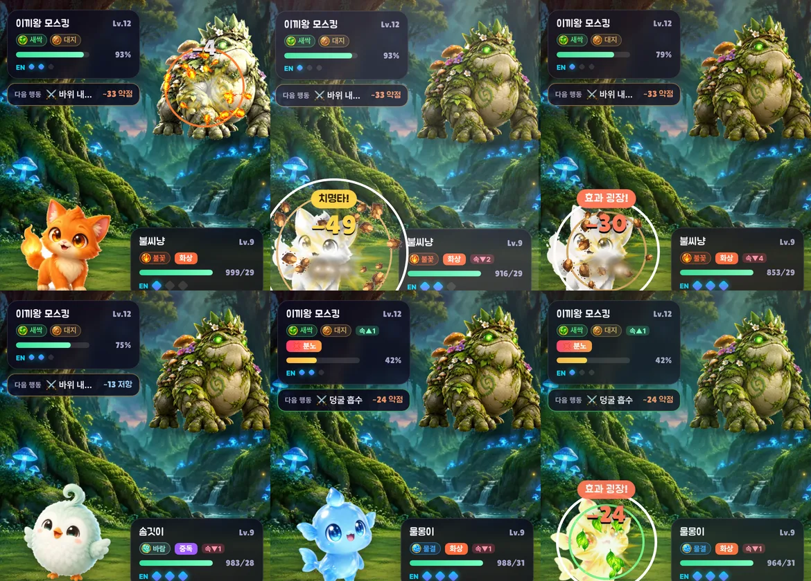

# ECHOLING v0.6 — 속성 이펙트 + 체형별 모션

## 1. 문제
v0.5까지 전투 연출은 **이미지 한 장을 통째로 움직이는 CSS 변형**뿐이었다 (숨쉬기·돌진·흔들림). 불꽃 기술이든 물 기술이든 똑같이 「앞으로 튀어나갔다 돌아옴」이라 속성 차이가 보이지 않았고, 34종이 모두 같은 리듬으로 움직였다.

## 2. ① 속성별 공격 이펙트 (캔버스 파티클 엔진 `src/ui/vfx.ts`)
| 속성 | 발사체 | 착탄 |
|---|---|---|
| 🔥 불꽃 | 불덩이 + 불씨 꼬리 | 불꽃 파편 사방 |
| 💧 물결 | 물방울 | 물방울이 중력으로 떨어짐 |
| 🌿 새싹 | 나뭇잎 5장이 흔들리며 날아감 | 잎사귀 흩날림 |
| ⚡ 번개 | 지그재그 번개 줄기 (즉시 연결) | 스파크 |
| 🪨 대지 | 바위 3개 포물선 투척 | 파편 + 흙먼지 |
| 🌪️ 바람 | 회전하는 바람 칼날 | 바람 파편 |
| 🌑 그림자 | 보랏빛 영혼 4개가 굽이치며 | 안쪽으로 빨려드는 링 |
| ✨ 빛 | 별빛 | 별 파편 |
| ⚪ 무속성 | 짧은 돌진 잔상 | 공통 폭발 |

공통 연출
- **대기술(EN 2 이상)**: 발사 전 기 모으기 (입자가 몸으로 빨려듦 + 몸 떨림)
- **치명타·효과 굉장**: 흰 링 + 화면 섬광 + 70ms 히트스톱 (타격감)
- **빗나감**: 발사체가 상대를 지나쳐 날아가고, 상대는 옆으로 회피
- **연타기**: 2타부터 짧은 발사체를 한 번 더
- 강화/약화/상태이상/회복 = 오라 입자, 기절 = 연기, 등장 = 착지 링 + 먼지 + 반짝
- 반동·가시·화상·중독 피해는 작은 착탄 (기술 직격과 구분 — 엔진 `hit.src` 필드)
- 발사음: 속성별 노이즈 스윕 합성음 (대지 = 낮고 묵직, 번개 = 높고 지직)

### 텍스처 제작 (Canva)
- Canva AI로 3×3 이펙트 텍스처 시트 1장 생성 → 디자인 페이지에 배치해 원본 해상도(1264px)로 내보내기 → `art/vfx-1264.webp`
- `tools/ui_assets.py`가 9칸으로 자름. 빛·연기류는 흰 배경에 부드럽게 번진 형태라 일반 컷아웃 대신 **color-to-alpha(흰색 키)** 로 반투명 글로우를 보존하고, 폭발은 흰 코어를 방사형 알파로 복원 → `public/fx/fx_*.webp` (160px, 총 ~115KB)

## 3. ② 체형별 모션 (7체형 × 대기/공격/등장)
| 체형 | 대기 | 공격 |
|---|---|---|
| round 둥근형 | 통통 튀는 숨쉬기 | 웅크렸다 덮치기 |
| tall 직립형 | 좌우로 살짝 흔들 | 웅크렸다 덮치기 |
| quad 네발형 | 숨쉬다 가끔 깡총 | 몸을 낮췄다 멀리 돌진 |
| bird 새형 | 공중 호버링 (그림자도 작아짐) | 솟구쳤다 급강하 |
| blob 말랑형 | 젤리처럼 출렁 | 납작 눌렸다 튕겨 나감 |
| serpent 뱀형 | S자로 꿈틀 | 뒤로 감았다 쏘아 물기 |
| golem 거대형 | 느리고 무거운 호흡 | 들어올렸다 내려찍기 (화면 흔들림) |

- **피격**: 공격자 반대 방향으로 밀려남 (치명타·약점이면 더 크게 + 붉은 섬광)
- **등장**: 위에서 떨어져 착지하며 출렁 (새는 옆에서 날아 들어옴)
- **빈사(HP 25%↓)**: 숨을 헐떡이는 빠른 호흡
- 모든 전투 모션은 배속(x1~x3)에 맞춰 길이가 줄어듦 → x3에서도 동작이 잘리지 않음
- 두 마리의 대기 모션 위상을 엇갈리게 해 기계적인 느낌 제거

### 솔직한 한계
- 일러스트가 **한 장짜리 이미지**라 눈 깜빡임·입 벌리기·팔다리 개별 움직임은 불가능 (프레임 애니메이션이나 파츠 분리 리깅이 필요 → 34종 × 여러 장 추가 생성이 필요한 별도 작업)

## 4. 검증 중 발견해 고친 문제
| 문제 | 원인 | 수정 |
|---|---|---|
| 보스전에서 매 턴 보스가 사라졌다 나타남 (v0.2부터 존재) | 등장 연출 클래스가 남아 있어 스프라이트를 다시 그릴 때마다 재생 | 1.2초 후 클래스 제거 |
| 대기 모션이 매 턴 처음부터 튐 | 턴마다 스프라이트 DOM을 새로 생성 | 같은 개체면 재생성하지 않음 |
| 폭발 텍스처 가운데가 뚫림 | 흰 코어가 광선 사이로 배경과 연결돼 투명 처리 | 방사형 알파로 코어 복원 |
| 치명타 섬광이 과함 | 화면 전체 0.4 | 0.28로 완화 |

- 테스트 51개 통과 · 자동 플레이 오류 0 · 9속성 쇼케이스 녹화 확인
- `설정 > 모션 줄이기`를 켜면 파티클 절반·섬광 없음
