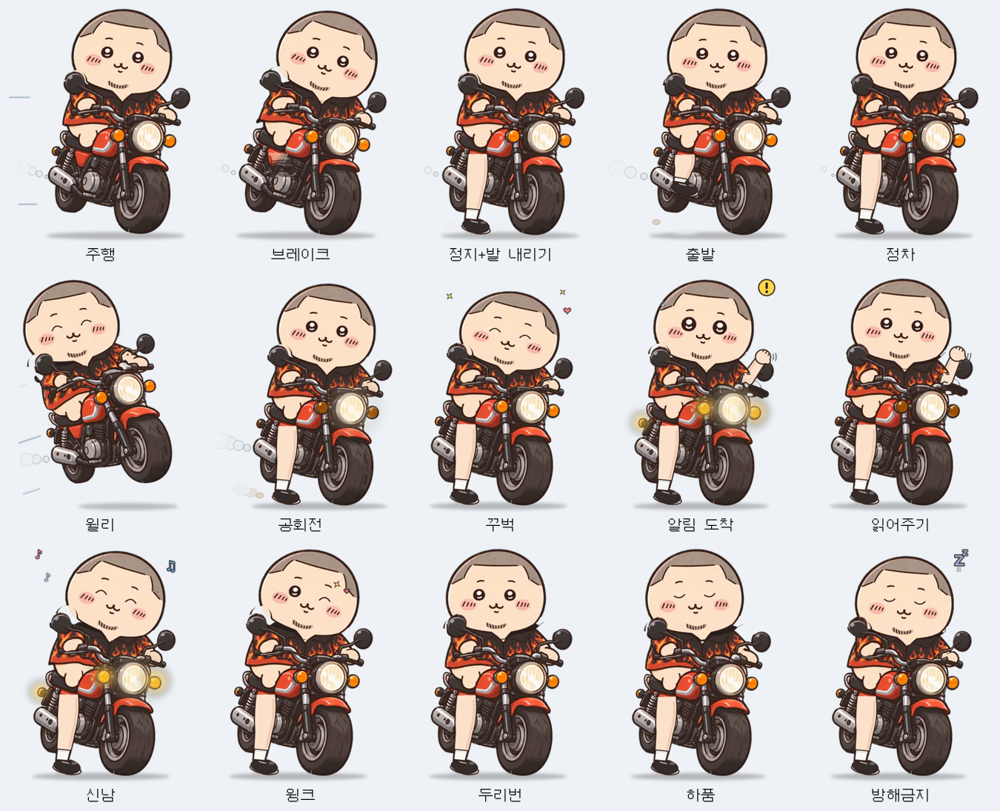
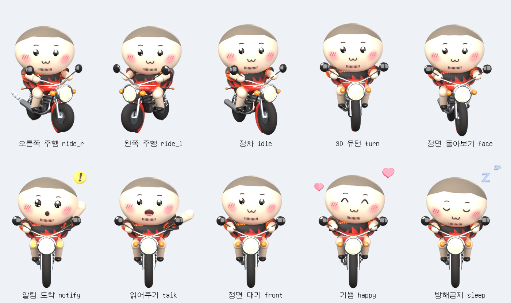
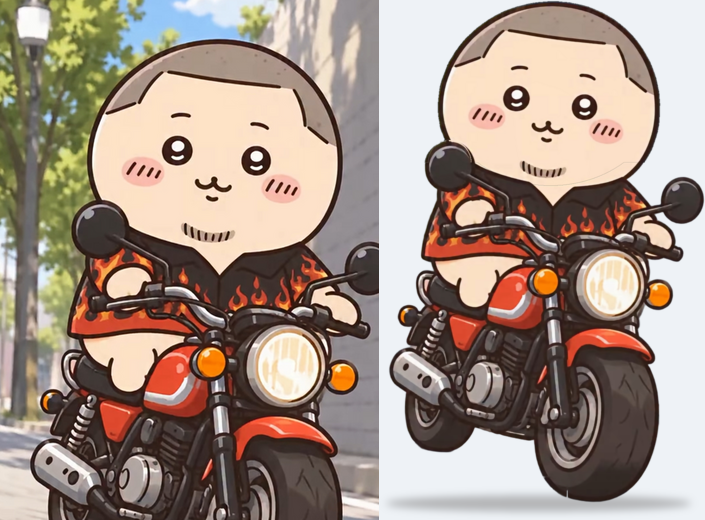

# 🏍️ Ride Buddy — 알림 읽어주는 라이더 캐릭터 (2D / 3D)

바탕화면 아래쪽을 **바이크 탄 캐릭터가 천천히 돌아다니다가**, 알림이 오면
**멈춰서 → 느낌표 + 비상등 + "빵빵!" → 말풍선으로 무슨 알림인지 알려주는** 데스크톱 앱입니다.

기본 캐릭터는 **원본 일러스트를 그대로 움직이는 2D**이며, 보관용 3D 버전도 트레이 메뉴 **캐릭터 스타일**에서 바꿔 볼 수 있습니다.

| 2D — 원본 일러스트 그대로 (기본값) | 3D — Blender 모델 |
|---|---|
|  |  |

원본과 2D 비교 (왼쪽: 원본 / 오른쪽: 앱 캐릭터)



---

## 🎨 2D — 원본 일러스트 컷아웃 리그 (`2d/build_2d.py`)

다시 그리지 않고 **원본 그림의 픽셀을 그대로** 사용합니다.

1. **AI 누끼**: rembg + BiRefNet 모델로 배경 제거 → `2d/source/character_cut.png`
2. **복원**: 스크린샷 UI("팔로우" 버튼)가 겹친 앞바퀴를 OpenCV 인페인팅으로 복원
3. **파츠 분리**: 머리 / 몸+바이크 / 머리 앞 미러 → 머리를 따로 움직여도 빈틈이 없도록 목·어깨를 셔츠색으로 채움
4. **표정**: 눈·입을 인페인팅으로 지우고 원본 선 색·굵기로 다시 그림 — 감은 눈, ^^ 눈, 반짝 눈(원본 눈 확대 + 별), 말하는 입, 놀란 입
5. **손 흔들기**: 핸들 잡은 오른손을 지우고 그립·핸들바를 다시 그린 뒤, 소매 안에서 통통한 팔이 올라와 "안녕!" 하고 흔듦
6. **바퀴 굴러가기**: 타이어 면에만 트레드 줄무늬가 흘러가도록 마스크 처리 (포크·펜더는 그대로)
7. **효과**: 비상등 점멸(원본 깜빡이 색 보정 + 발광), 전조등 번쩍, 느낌표, Zzz, 하트, 배기 연기, 스피드라인 — 원본과 같은 갈색 외곽선 스타일

## 🧊 3D — Blender 모델 (`3d/ride_buddy_3d.py`, 원본 파일 `3d/ride_buddy.blend`)

서브디비전 메시 + PBR 재질(피부·크롬·광택 도장·고무) + Cycles 렌더. 3D 유턴, 정면 돌아보기, 손 흔들기 모션 포함.

## 🎬 모션 (두 스타일 공통 이름)

| 모션 | 설명 | 루프 |
|---|---|---|
| `ride_r` / `ride_l` | 좌/우 주행 (바퀴 굴러감·진동·들썩임·배기 연기) | ✅ |
| `idle_r` / `idle_l` | 정차 (숨쉬기·두리번·깜빡임) | ✅ |
| `turn` | 유턴 (왼→오, 역재생 = 오→왼) | — |
| `face_r` / `face_l` | 알림 받을 자세로 전환 (역재생 = 다시 출발) | — |
| `notify` | 알림 도착: 반짝 눈·놀란 입·느낌표·비상등·전조등·손 흔들기 | — |
| `talk` | 알림 읽어주기: 입 뻐끔·끄덕·손 흔들기 | ✅ |
| `front` | 대기 (말풍선 보는 중) | ✅ |
| `happy` | 기쁨: ^^ 눈·통통·하트 | ✅ |
| `sleep` | 방해 금지: 꾸벅꾸벅·Zzz | ✅ |

`motions/2d/`, `motions/3d/` 에 모션마다 **투명 애니메이션 WebP**, **GIF**, **스프라이트 시트**, `motions.json` 이 있습니다.

### 다시 만들기
```bash
# 2D (Python: pillow numpy opencv-python-headless, 누끼를 다시 딸 때만 rembg[cpu])
npm run render2d && npm run pack2d
python 2d/build_2d.py --still preview.png --motion notify --t 0.6     # 한 장 미리보기

# 3D (Python 3.13 + bpy==5.2.3 + pillow, CPU 4코어 기준 약 40~60분)
npm run render3d && npm run pack3d
```

---

## 🏍️ 실제 오토바이 같은 주행 (`src/renderer/buddy.js` — 주행 물리)

그림이 일정한 속도로 미끄러지는 대신, 매 프레임 물리 계산으로 움직입니다. ([주행 데모 영상](docs/demo-ride.mp4))

| 요소 | 동작 |
|---|---|
| 원근(깊이) | 멀리 가면 **작아지고 화면 위쪽**으로, 가까이 오면 **커지고 아래쪽**으로 — 차선을 바꾸듯 앞뒤로 오가며 주행 |
| 가속·감속 | 출발 시 서서히 가속, 주행 중 속도 변화, 멈출 때 브레이크로 감속 (화면 끝은 제동 거리를 계산해 미리 감속 → 유턴) |
| 차체 피치 | 가속하면 **앞이 살짝 들리고**, 브레이크 밟으면 **앞으로 쏠림** |
| 기울기 | 깊이 방향으로 핸들을 꺾을 때 그쪽으로 **기울어짐**, 멈추면 바로 섬 |
| 서스펜션 | 노면 요철에 **통통 튀고 출렁이는** 스프링 반동 |
| 바퀴·배기 | 스프라이트 재생 속도가 **실제 속도에 연동** (느리면 바퀴도 천천히) |
| 알림 반응 | 알림이 오면 **브레이크를 밟으며 사용자 쪽으로 핸들을 꺾어 다가온 뒤** 멈춰서 알려줌 |

## ✨ 앱 기능

| 구분 | 내용 |
|---|---|
| 🛵 이동 | 작업표시줄 위를 좌우로 천천히 주행 · 랜덤 정차 · 화면 끝에서 유턴 |
| 🔔 알림 | 멈춤 → `!` + 비상등 + "빵빵" → 말풍선에 **앱 이름 · 제목 · 내용** 타이핑 |
| 📥 알림 출처 | ① **Windows 알림 센터** (카카오톡·Outlook·Slack·Teams·크롬 웹푸시 등 모든 토스트) ② **로컬 API** |
| 🎤 유행어 리액션 | 알림이 오면 엔진을 **"달! 달! 달! 달!"** 공회전(차체 떨림 + 합성 엔진음) → **"감사하고~♥"** (띵동) → 알림 읽기. 캐릭터 클릭 시 "감사하고~♥". 트레이에서 끄기 가능 |
| 🗂 대기열 | 알림이 몰리면 `+N` 표시 후 순서대로 읽어줌 |
| 😴 방해 금지 | 졸기 모션 + 미확인 개수 배지 → 해제하면 쌓인 알림을 차례로 읽어줌 |
| 🖱 인터랙션 | 클릭: 기뻐하기 / 말풍선 닫기 · 더블클릭: 마지막 알림 다시 듣기 · 드래그: 위치 이동 · 우클릭: 메뉴 |
| ⚙️ 트레이 메뉴 | **캐릭터 스타일(2D/3D)**, 유행어 리액션, 테스트 알림, 이동 멈춤, 방해 금지, 알림음, 내용 표시, 크기, 속도, 자동 실행 |
| 🪟 방해 최소화 | 투명·클릭 통과 창 (캐릭터/말풍선 위에서만 마우스 반응), 포커스 뺏지 않음 |

## 🚀 실행
```bash
cd ride-buddy
npm install
npm start            # 트레이에 얼굴 아이콘이 생깁니다
npm run dist:win     # Windows 설치 파일(NSIS) + 포터블 exe → dist/
```
브라우저 미리보기: `src/renderer/index.html` 을 열면 데모 버튼(알림/방해 금지/멈춤/크기/2D·3D)이 나타납니다.

## 📮 알림 보내기 (로컬 API, 127.0.0.1 전용)
```bash
npm run notify -- "배포 완료" "v2.0 릴리즈 끝!" "GitHub"
curl -X POST http://127.0.0.1:47321/notify -H "Content-Type: application/json" -d '{"app":"빌드봇","title":"빌드 성공","body":"3분 12초"}'
curl "http://127.0.0.1:47321/notify?app=메모&title=회의&body=3시"
```

## 🪟 Windows 알림 센터 연동
Windows 10/11 은 모든 앱의 토스트 알림을 `%LOCALAPPDATA%\Microsoft\Windows\Notifications\wpndatabase.db`(SQLite)에 기록합니다.
Ride Buddy 는 이 파일을 **읽기 전용**으로 2초마다 확인해 새 토스트만 읽습니다 (Electron 37 내장 `node:sqlite`, 관리자 권한 불필요).
- 실행 이전 알림은 무시합니다. · 카카오톡 "알림 미리보기"를 끄면 제목만 옵니다.
- 특정 앱 무시: 트레이 → 설정 폴더 열기 → `config.json` 의 `"mutedApps": ["Chrome"]`

## 🗂 구조
```
ride-buddy/
├─ 2d/build_2d.py             원본 일러스트 컷아웃 리그 + 모션 렌더
├─ 2d/source/                 누끼 딴 원본 캐릭터
├─ 3d/ride_buddy_3d.py        Blender 모델링·재질·조명·모션·렌더
├─ 3d/ride_buddy.blend        Blender 원본 파일
├─ tools/pack_sprites.py      렌더 프레임 → 앱 스프라이트 / WebP·GIF·시트 / 아이콘
├─ src/main/                  Electron 메인: 오버레이 창 · 트레이 · 로컬 API · Windows 알림 리더
├─ src/renderer/              스프라이트 플레이어 · 이동 AI · 말풍선 · 경적음
│  └─ sprites/{2d,3d}/        스타일별 모션 스프라이트 시트 (WebP) + 메타데이터
├─ motions/{2d,3d}/           배포용 모션 에셋
├─ assets/                    아이콘
└─ test/                      단위 테스트 (npm test)
```

## ⚠️ 캐릭터 저작권
캐릭터는 원작자(인스타그램 `yoonmojun`)의 창작물이며, 2D 스타일은 **원본 그림을 그대로** 사용합니다.
개인 PC 사용은 문제가 적지만 **배포·판매(스토어 등록, 이모티콘 판매 등)** 전에는 반드시 원작자 허락을 받으세요.
