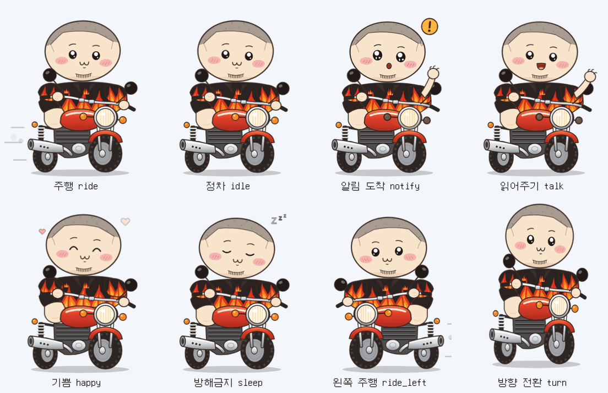

# 🏍️ Ride Buddy — 알림 읽어주는 라이더 캐릭터

바탕화면 아래쪽을 **빨간 바이크를 타고 천천히 돌아다니다가**, 알림이 오면 멈춰서
**느낌표를 띄우고 "빵빵!" 경적을 울린 뒤 말풍선으로 무슨 알림인지 알려주는** 데스크톱 캐릭터입니다.



| 실제 데스크톱 화면 (Electron 실행 캡처) | 캐릭터 원화 (SVG 모델) |
|---|---|
|  |  |

---

## ✨ 기능

| 구분 | 내용 |
|---|---|
| 🛵 이동 | 작업표시줄 위를 좌우로 천천히 주행 · 랜덤 정차 · 화면 끝에서 유턴 |
| 🔔 알림 | `!` 팝업 + 비상등 깜빡 + 손 흔들기 + "빵빵" → 말풍선에 **앱 이름 · 제목 · 내용** 타이핑 |
| 📥 알림 출처 | ① **Windows 알림 센터** (카카오톡, Outlook, Slack, Teams, 크롬 웹푸시 등 모든 토스트 알림) ② **로컬 API** (스크립트·자동화 연동) |
| 🗂 대기열 | 알림이 몰리면 `+N` 표시 후 순서대로 읽어줌 |
| 😴 방해 금지 | 캐릭터가 졸고(Zzz) 빨간 배지에 미확인 개수 표시 → 해제하면 쌓인 알림을 차례로 읽어줌 |
| 🖱 인터랙션 | 클릭: 기뻐하기 / 말풍선 닫기 · 더블클릭: 마지막 알림 다시 듣기 · 드래그: 위치 이동 · 우클릭: 메뉴 |
| ⚙️ 트레이 메뉴 | 테스트 알림, 이동 멈춤, 방해 금지, 알림음, 내용 표시(사생활 보호), 크기(작게/보통/크게), 속도, 자동 실행 |
| 🪟 방해 최소화 | 투명·클릭 통과 창 (캐릭터/말풍선 위에서만 마우스 반응), 포커스 뺏지 않음, 작업표시줄 아이콘 없음 |

---

## 🚀 실행

```bash
cd ride-buddy
npm install
npm start          # 앱 실행 (트레이에 얼굴 아이콘이 생깁니다)
```

브라우저만으로 미리보기: `src/renderer/index.html` 을 열면 데모 버튼(알림 보내기/방해 금지/멈춤/크기)이 나타납니다.

### Windows 설치 파일 만들기
```bash
npm run dist:win   # dist/ 에 설치판(NSIS) + 포터블 exe 생성
```

---

## 📮 알림 보내기 (로컬 API)

127.0.0.1 에만 열리므로 외부에서는 접근할 수 없습니다.

```bash
# Node
npm run notify -- "배포 완료" "v2.0 릴리즈 끝!" "GitHub"

# curl
curl -X POST http://127.0.0.1:47321/notify -H "Content-Type: application/json" \
     -d '{"app":"빌드봇","title":"빌드 성공","body":"3분 12초 걸렸어요"}'

# PowerShell
Invoke-RestMethod -Method Post -Uri http://127.0.0.1:47321/notify -ContentType 'application/json; charset=utf-8' `
  -Body (@{app='알람'; title='물 마실 시간'; body='한 컵 마셔요 💧'} | ConvertTo-Json)

# 브라우저 주소창 / 단축어 / IFTTT(로컬) 등
http://127.0.0.1:47321/notify?app=메모&title=회의&body=3시에%20B룸
```

| 필드 | 설명 |
|---|---|
| `app` | 앱 이름 (카카오톡/Slack/메일… 은 자동으로 전용 색·아이콘) |
| `title` | 제목 (필수: title 또는 body) |
| `body` | 내용 |

---

## 🪟 Windows 알림 센터 연동 원리

Windows 10/11 은 모든 앱의 토스트 알림을 `%LOCALAPPDATA%\Microsoft\Windows\Notifications\wpndatabase.db`(SQLite)에 기록합니다.
Ride Buddy 는 이 파일을 **읽기 전용**으로 2초마다 확인해 새 토스트만 읽습니다 (Electron 37 내장 `node:sqlite` 사용, 관리자 권한·네이티브 빌드 불필요).

- 앱 실행 이전 알림은 무시하고, 실행 이후 도착한 알림만 읽어줍니다.
- 카카오톡에서 **"알림 미리보기"를 끄면** 내용 없이 제목만 옵니다 (Windows 설정 → 알림에서 해당 앱 알림이 켜져 있어야 함).
- 트레이 메뉴 → "메시지 내용 표시"를 끄면 "OO에서 새 알림이 왔어요!"만 표시합니다 (회의·화면공유 시 사생활 보호).
- 특정 앱 무시: 설정 폴더(트레이 → 설정 폴더 열기)의 `config.json` → `"mutedApps": ["Chrome"]`

> macOS/Linux 에서는 로컬 API 로 알림을 보내 사용합니다.

---

## 🎨 캐릭터 모델링 & 모션

캐릭터는 레퍼런스 이미지를 기준으로 **레이어 분리형 SVG** 로 직접 모델링했습니다 (`src/renderer/character.js`).
머리·눈(4종)·입(3종)·팔·바퀴·전조등·배기연기 등 파츠별 `id` 가 있어 CSS 만으로 모션을 줍니다 (`src/renderer/character.css`).

| 모션 | 클래스 | 설명 | 길이 |
|---|---|---|---|
| ride | `rb--ride` | 바퀴 회전, 엔진 진동, 들썩임, 배기연기, 스피드라인 | 4.8s 루프 |
| idle | `rb--stop` | 숨쉬기, 두리번, 눈 깜빡임 | 4.8s 루프 |
| notify | `rb--notify` | `!` 팝, 반짝 눈, 놀란 입, 비상등, 전조등 번쩍, 손 흔들기 | 2.4s |
| talk | `rb--talk` | 입 뻐끔, 끄덕끄덕, 손 흔들기 | 2.4s 루프 |
| happy | `rb--happy` | ^^ 눈, 통통 튀기, 하트 | 2.4s 루프 |
| sleep | `rb--sleep` | 눈 감고 꾸벅, Zzz | 4.8s 루프 |
| turn | `rb--turn` | 방향 전환 스쿼시 | 0.6s |

### 추출된 모션 에셋 (`motions/`)
- `*.gif` — 투명 배경 GIF (메신저 이모티콘·프레젠테이션용)
- `*_sheet.png` — 스프라이트 시트 (10열 그리드, 312×382/프레임, 15fps)
- `motions.json` — 프레임 수·크기·fps 메타데이터 (Unity/Godot/웹 게임 엔진에 바로 사용)

```bash
npx playwright install chromium   # 최초 1회
npm run motions                   # 모든 모션 재추출 (ffmpeg, ImageMagick 필요)
npm run motions -- --only talk --width 360 --fps 24
npm run icons                     # 트레이/앱 아이콘 재생성
```

---

## 🗂 구조

```
ride-buddy/
├─ src/main/
│  ├─ main.js                 투명 오버레이 창 · 트레이 · 알림 정규화/중복 제거
│  ├─ preload.js              렌더러 브리지 (contextIsolation)
│  ├─ http-server.js          로컬 알림 API
│  ├─ config.js               사용자 설정 (userData/config.json)
│  ├─ app-names.js            앱 → 이름/아이콘/색상
│  └─ watchers/windows-notifications.js   Windows 알림 센터 리더
├─ src/renderer/
│  ├─ character.js / .css     캐릭터 모델 + 모션
│  ├─ buddy.js / .css         이동 AI · 말풍선 · 인터랙션 · 경적 사운드(WebAudio)
│  └─ index.html
├─ tools/                     모션 추출 · 아이콘 생성 · 알림 전송 CLI
├─ motions/                   추출된 GIF · 스프라이트 시트
├─ assets/                    아이콘 (ico/png)
└─ test/                      단위 테스트 (npm test)
```

## ⚠️ 캐릭터 저작권
레퍼런스 캐릭터는 원작자(인스타그램 `yoonmojun`)의 창작물입니다. 개인 PC에서 쓰는 것은 문제가 적지만,
**배포·판매(스토어 등록, 이모티콘 판매 등)** 전에는 반드시 원작자 허락을 받거나 캐릭터 디자인을 변경하세요.
`character.js` 의 색상 팔레트(`C`)와 파츠 경로만 바꾸면 다른 캐릭터로 쉽게 교체할 수 있습니다.
