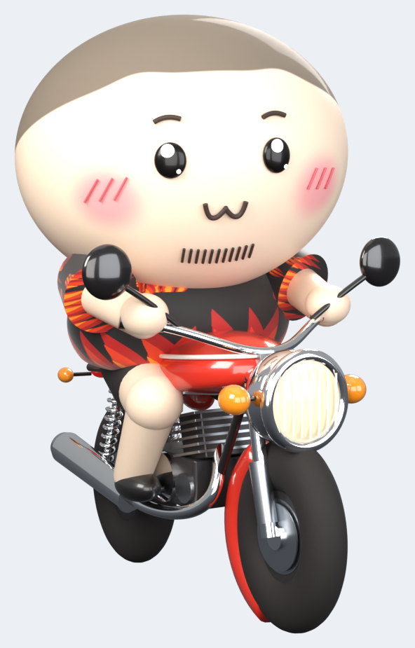

# 🏍️ Ride Buddy 3D — 알림 읽어주는 라이더 캐릭터

바탕화면 아래쪽을 **3D 캐릭터가 빨간 바이크를 타고 천천히 돌아다니다가**, 알림이 오면
**정면으로 돌아보고 → 느낌표 + 비상등 + "빵빵!" → 손을 흔들며 말풍선으로 무슨 알림인지 알려주는** 데스크톱 앱입니다.


| 3D 모델 (Blender · Cycles 렌더) | 실제 데스크톱 화면 (Electron 실행 캡처) |
|---|---|
|  |  |

---

## 🎨 3D 모델링 (Blender)

`3d/ride_buddy_3d.py` 하나로 **모델링 → 재질 → 조명 → 모션 → 렌더**까지 재현됩니다.

| 파트 | 모델링 방식 |
|---|---|
| 머리 | 서브디비전 타원체 메시 + 전용 셰이더 (피부 SSS, M자 헤어라인 스포츠머리 + 머리결 범프, 볼터치 그라데이션) |
| 얼굴 | 눈(유광 + 하이라이트), 눈썹·ω입·턱수염·볼 빗금 = 얼굴 표면에 투영한 3D 커브 |
| 표정 | 눈 4종(기본/웃음/감음/반짝) · 입 3종(ω/말하기/놀람) 교체식 |
| 몸 | 불꽃 셔츠(절차적으로 생성한 불꽃 텍스처), 반바지, 통통한 팔다리, 손 |
| 바이크 | 타이어(트레드 범프)·5스포크 휠·디스크, 레드 코트 도장 탱크 + 핀스트라이프, 크롬 전조등·포크·핸들·머플러, 냉각핀 엔진, 스프링 쇼크, 깜빡이·테일램프(발광) |
| FX | 느낌표 배지, Zzz(3D 텍스트), 하트, 배기 연기 |
| 렌더 | Cycles (CPU) + OpenImageDenoise, 스튜디오 조명 4등, 투명 배경 |

### 모션 12종 (`motions/`)

| 모션 | 설명 | 루프 |
|---|---|---|
| `ride_r` / `ride_l` | 좌/우 주행 — 바퀴 회전, 차체 진동, 들썩임, 배기 연기 | ✅ |
| `idle_r` / `idle_l` | 정차 — 숨쉬기, 두리번, 눈 깜빡임 | ✅ |
| `turn` | **3D 유턴** (왼→오, 역재생 = 오→왼) | — |
| `face_r` / `face_l` | 주행 방향 → **정면으로 돌아보기** (역재생 = 다시 출발) | — |
| `notify` | 알림 도착 — 반짝 눈, 놀란 입, 느낌표, 비상등 점멸, 전조등 번쩍, 손 들기 | — |
| `talk` | 알림 읽어주기 — 입 뻐끔, 끄덕, 손 흔들기, 비상등 | ✅ |
| `front` | 정면 대기 (말풍선 보는 중) | ✅ |
| `happy` | 기쁨 — ^^ 눈, 통통 튀기, 하트 | ✅ |
| `sleep` | 방해 금지 — 꾸벅꾸벅, Zzz | ✅ |

각 모션마다 **투명 애니메이션 WebP**, **GIF**, **스프라이트 시트 PNG**, `motions.json`(프레임 메타데이터)을 제공합니다.

### 다시 렌더하기
```bash
python -m venv .venv && .venv/bin/pip install bpy==5.2.3 pillow   # Blender 5.2 (Python 3.13)
npm run render3d          # 3d/out/<motion>/frame_*.png  (CPU 4코어 기준 약 40~60분)
npm run pack3d            # → src/renderer/sprites/*.webp, motions/*, assets/icon*
# 한 장만 미리보기
python 3d/ride_buddy_3d.py --still preview.png --motion notify --t 0.9 --res 800 --samples 64
# Blender 앱에서 열기/수정용 .blend 저장
python 3d/ride_buddy_3d.py --blend ride_buddy.blend
```

---

## ✨ 앱 기능

| 구분 | 내용 |
|---|---|
| 🛵 이동 | 작업표시줄 위를 좌우로 천천히 주행 · 랜덤 정차 · 화면 끝에서 3D 유턴 |
| 🔔 알림 | 정면 돌아보기 → `!` + 비상등 + "빵빵" → 손 흔들며 말풍선에 **앱 이름 · 제목 · 내용** 타이핑 |
| 📥 알림 출처 | ① **Windows 알림 센터** (카카오톡·Outlook·Slack·Teams·크롬 웹푸시 등 모든 토스트) ② **로컬 API** |
| 🗂 대기열 | 알림이 몰리면 `+N` 표시 후 순서대로 읽어줌 |
| 😴 방해 금지 | 졸기 모션 + 미확인 개수 배지 → 해제하면 쌓인 알림을 차례로 읽어줌 |
| 🖱 인터랙션 | 클릭: 기뻐하기 / 말풍선 닫기 · 더블클릭: 마지막 알림 다시 듣기 · 드래그: 위치 이동 · 우클릭: 메뉴 |
| ⚙️ 트레이 메뉴 | 테스트 알림, 이동 멈춤, 방해 금지, 알림음, 내용 표시(사생활 보호), 크기, 속도, 자동 실행 |
| 🪟 방해 최소화 | 투명·클릭 통과 창 (캐릭터/말풍선 위에서만 마우스 반응), 포커스 뺏지 않음 |

## 🚀 실행
```bash
cd ride-buddy
npm install
npm start            # 트레이에 얼굴 아이콘이 생깁니다
npm run dist:win     # Windows 설치 파일(NSIS) + 포터블 exe → dist/
```
브라우저 미리보기: `src/renderer/index.html` 을 열면 데모 버튼이 나타납니다.

## 📮 알림 보내기 (로컬 API, 127.0.0.1 전용)
```bash
npm run notify -- "배포 완료" "v2.0 릴리즈 끝!" "GitHub"
curl -X POST http://127.0.0.1:47321/notify -H "Content-Type: application/json" -d '{"app":"빌드봇","title":"빌드 성공","body":"3분 12초"}'
curl "http://127.0.0.1:47321/notify?app=메모&title=회의&body=3시"
```
```powershell
Invoke-RestMethod -Method Post -Uri http://127.0.0.1:47321/notify -ContentType 'application/json; charset=utf-8' `
  -Body (@{app='알람'; title='물 마실 시간'; body='한 컵 마셔요'} | ConvertTo-Json)
```

## 🪟 Windows 알림 센터 연동
Windows 10/11 은 모든 앱의 토스트 알림을 `%LOCALAPPDATA%\Microsoft\Windows\Notifications\wpndatabase.db`(SQLite)에 기록합니다.
Ride Buddy 는 이 파일을 **읽기 전용**으로 2초마다 확인해 새 토스트만 읽습니다 (Electron 37 내장 `node:sqlite`, 관리자 권한 불필요).
- 실행 이전 알림은 무시합니다.
- 카카오톡 "알림 미리보기"를 끄면 내용 없이 제목만 옵니다.
- 특정 앱 무시: 트레이 → 설정 폴더 열기 → `config.json` 의 `"mutedApps": ["Chrome"]`

## 🗂 구조
```
ride-buddy/
├─ 3d/ride_buddy_3d.py        Blender 모델링·재질·조명·모션·렌더 (단일 스크립트)
├─ 3d/pack_sprites.py         렌더 프레임 → 앱 스프라이트 / WebP·GIF·시트 / 아이콘
├─ src/main/                  Electron 메인: 오버레이 창 · 트레이 · 로컬 API · Windows 알림 리더
├─ src/renderer/              스프라이트 플레이어 · 이동 AI · 말풍선 · 경적음
│  └─ sprites/                3D 모션 스프라이트 시트 (WebP) + 메타데이터
├─ motions/                   배포용 모션 에셋 (WebP 애니메이션 · GIF · 시트 · motions.json)
├─ assets/                    아이콘 (3D 렌더에서 생성)
└─ test/                      단위 테스트 (npm test)
```

## ⚠️ 캐릭터 저작권
레퍼런스 캐릭터는 원작자(인스타그램 `yoonmojun`)의 창작물입니다. 개인 PC 사용은 문제가 적지만,
**배포·판매(스토어 등록, 이모티콘 판매 등)** 전에는 반드시 원작자 허락을 받거나 디자인을 변경하세요.
