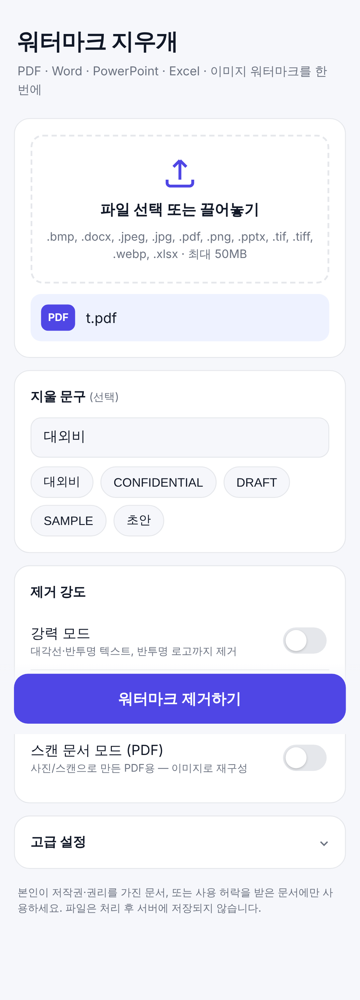
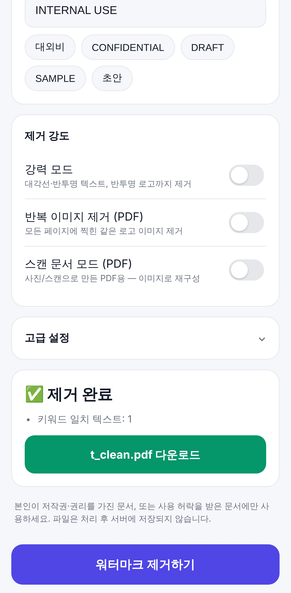

# 워터마크 지우개 (wmremover)

PDF · Word · PowerPoint · Excel · 이미지의 워터마크를 제거하는 **CLI + 모바일 웹 UI** 도구입니다.

<p>
 
</p>

> ⚖️ **사용 범위** — 본인이 작성·소유한 문서, 또는 권리자에게 허락받은 문서에만 사용하세요.
> 타인의 저작물 보호 표시를 지우는 것은 저작권법(제104조의3 등) 위반이 될 수 있습니다.
> 암호화된 PDF는 정당한 암호(`--password`) 없이는 처리하지 않습니다.

---

## 1. 지원 형식과 제거 방식

| 형식 | 기본 (자동) | `-t 문구` | `--aggressive` | 기타 |
|---|---|---|---|---|
| **PDF** | `/Watermark` 주석, `/Artifact Watermark` 태그, 워터마크 레이어(OCG), 이름이 Watermark인 폼 | 일치 텍스트 삭제 (ToUnicode·한글 CJK 지원), 스탬프 주석 | 대각선 회전 텍스트, 반투명 텍스트·이미지, 모든 스탬프 | `--repeated-images` 반복 로고, `--raster` 스캔 PDF |
| **DOCX** | Word 워터마크(VML 워드아트·그림), 워터마크 SDT 블록 | 머리글/바닥글·도형 속 문구 | 헤더의 '글 뒤' 그림/도형, 페이지 배경 | |
| **PPTX** | 이름이 Watermark인 도형 (마스터·레이아웃·슬라이드) | 일치 텍스트 도형 | 회전 텍스트, 반투명 이미지·텍스트 | |
| **XLSX** | 머리글/바닥글 그림(`&G`), 시트 배경 그림 | 머리글 문구, 도형·텍스트상자 | 반투명 이미지 도형 | |
| **이미지** | 문서형 → 옅은 회색 제거 / 사진형 → 반투명 흰 글씨 인페인팅 | — | — | `--region`, `--mask`, `--color` |

**원칙**: 문서 형식(PDF/Office)은 워터마크 요소만 정확히 지우고 본문 텍스트·벡터는 그대로 보존합니다(비파괴). 원본 파일은 절대 덮어쓰지 않으며 `*_clean.*` 으로 저장됩니다.

## 2. 설치

```bash
cd watermark-remover
pip install -e .            # 또는 pip install -r requirements.txt
```

## 3. 사용법 (CLI)

```bash
wmremove report.pdf                          # 표준 워터마크 자동 제거
wmremove report.pdf -t 대외비 -t DRAFT        # 문구 지정
wmremove docs/*.docx docs/*.pptx -o cleaned/ -a
wmremove scan.pdf --raster --dpi 300         # 스캔(이미지) PDF
wmremove photo.jpg --region 20,30,300,80     # 영역 인페인팅 (x,y,w,h)
wmremove contract.png --color "#D22C2C" --tol 60   # 빨간 도장
wmremove page.png --mode threshold --threshold 170 # 밝기 기준 수동
```

결과 예:
```
[PDF] t.pdf → t_clean.pdf
  - 키워드 일치 텍스트: 1
```

### 어떤 옵션을 써야 할까? (결정 순서)
1. 옵션 없이 실행 → 표준 워터마크는 대부분 제거
2. 남아 있으면 `-t "보이는 문구"` 추가
3. 그래도 남으면 `-a` (대각선/반투명 휴리스틱)
4. 로고 그림이면 PDF는 `--repeated-images`, 이미지는 `--region`
5. 텍스트 선택이 안 되는 스캔 PDF면 `--raster`

## 4. 모바일 웹 UI

```bash
wmremove-web                  # 또는 python -m wmremover.web.app
# 같은 Wi-Fi의 안드로이드 폰에서 http://<PC IP>:8000 접속
```
- 파일 선택 → 문구 칩 탭 → 토글 → 하단 고정 버튼 한 번으로 처리
- 이미지는 미리보기에서 **손가락으로 드래그해 지울 영역 지정**
- 다크 모드, 48dp 이상 터치 영역, safe-area 대응

## 5. Python API

```python
from wmremover import remove_watermark, Options
rep = remove_watermark("in.pdf", "out.pdf", Options(keywords=["대외비"], aggressive=True))
print(rep.summary())
```

## 6. 테스트

```bash
pip install -e ".[test]" && pytest -q     # 14개: 형식별 샘플을 생성해 제거 검증
```

## 7. 한계
- 본문과 **같은 색·같은 레이어**로 합쳐진 이미지 워터마크는 완벽 복원이 불가능합니다(인페인팅은 주변으로 추정).
- `--raster` 결과는 이미지 PDF라 텍스트 선택이 안 됩니다.
- `.doc/.ppt/.xls/.hwp` 구형 형식은 먼저 최신 형식으로 저장 후 사용하세요.
